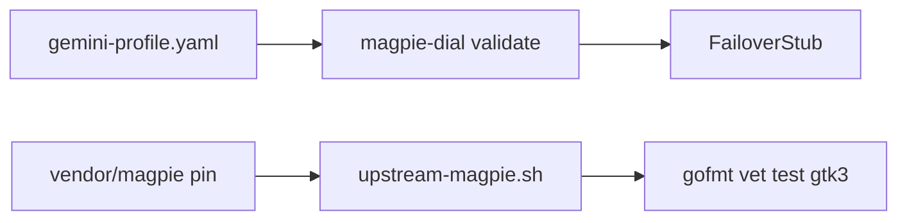

# minilab-magpie-gemini-dial

**Built by SkilledDragon LLC — architecture-led software engineering — [skilleddragon.com](https://skilleddragon.com)**

Palette: `#020617` / `#040F49` / `#006BDF` / `#00BFA6`

Python (uv/pytest) minilab: pin [yetone/magpie](https://github.com/yetone/magpie), run its Linux keyless CI (GTK + gofmt/vet/test), and validate a Magpie dial profile YAML that routes **Gemini CLI** through Magpie with quota-failover stub — always with `MAGPIE_NO_ACCOUNTS=1`.

| Piece | Purpose |
| --- | --- |
| `uv run magpie-dial <profile.yaml>` | Validate Gemini CLI + failover YAML (no live API) |
| `scripts/vendor-upstream.sh` | Clone + pin `vendor/magpie` (gitignored) |
| `scripts/upstream-magpie.sh` | Verbatim Linux suite from upstream `test.yml` |
| `.claude/skills/magpie-gemini-dial/` | Skill: Magpie dial + privacy + failover |
| CI | Jobs `lab`, `upstream`, `security` |

Upstream pin: [yetone/magpie](https://github.com/yetone/magpie) @ `e297a8ab27461ed32b03ce8be0f9bf957a2e754d` (MIT)

## What we built and why

Magpie is a local gateway for Claude Code, Codex, Gemini CLI, Antigravity, and many other agents: one provider list, atomic config edits, profiles, and routing groups that move to the next account or model when a quota window is exhausted.

This lab freezes Magpie at the pin above, re-runs the Linux keyless commands from `.github/workflows/test.yml`, and ships a keyless Python validator for a Gemini dial profile plus an in-process failover stub. CI never calls the Gemini API.



## What we tested

Verified upstream commands at `e297a8ab27461ed32b03ce8be0f9bf957a2e754d` (Linux job from `test.yml`):

```bash
export MAGPIE_NO_ACCOUNTS=1
sudo apt-get update
sudo apt-get install -y libgtk-3-dev libwebkit2gtk-4.1-dev
bad=$(gofmt -l $(git ls-files '*.go'))
if [ -n "$bad" ]; then echo "not gofmt'd:"; echo "$bad"; exit 1; fi
go vet -tags gtk3 ./...
# bun 1.4.2 on PATH (CI: oven-sh/setup-bun)
go test -tags gtk3 ./...
```

Lab keyless suite:

```bash
export MAGPIE_NO_ACCOUNTS=1 DISABLE_TELEMETRY=1 DO_NOT_TRACK=1
uv sync --locked --group dev
uv run ruff check .
uv run ruff format --check .
uv run pytest -q
python3 scripts/check-skills
python3 scripts/check-banned-phrases
python3 scripts/check-upstream-parity
```

Pass counts and tool versions: [RESULTS.md](RESULTS.md).

## Setup

Requires Python `>=3.10` (CI uses 3.12) and [uv](https://docs.astral.sh/uv/). Upstream job needs Go `1.26.8`, Bun `1.4.2`, and Linux GTK/WebKit packages (CI installs them).

```bash
git clone https://github.com/SkilledDragonCorp/minilab-magpie-gemini-dial.git
cd minilab-magpie-gemini-dial
cp .env.example .env
uv sync --locked --group dev
bash scripts/vendor-upstream.sh
```

Confirm the vendor pin:

```bash
git -C vendor/magpie rev-parse HEAD
# must print e297a8ab27461ed32b03ce8be0f9bf957a2e754d
```

Optional pre-commit (gitleaks `v8.30.1`):

```bash
uv run pre-commit install
```

## Tutorial

1. Validate the Gemini dial fixture:

```bash
uv run magpie-dial tests/fixtures/gemini-profile.yaml
```

2. Simulate quota failover (next member after the first is exhausted):

```bash
uv run magpie-dial tests/fixtures/gemini-profile.yaml --simulate-failover
```

3. Run the full keyless lab suite (commands in **What we tested**).

4. On Linux CI (or a Linux host with sudo): `bash scripts/upstream-magpie.sh`.

## Skills (Claude / Cursor)

Skills live only under `.claude/skills/<name>/SKILL.md`.

| Skill | When to use |
| --- | --- |
| `magpie-gemini-dial` | Route Gemini CLI / Antigravity through Magpie; keep `MAGPIE_NO_ACCOUNTS=1`; validate dial YAML and failover stub |

Do not add `.cursor/skills` or `.agents/skills` mirrors.

## Environment / API keys

| Variable | Required for CI | Purpose |
| --- | --- | --- |
| `MAGPIE_NO_ACCOUNTS=1` | Yes | Disable Magpie subscription-account discovery |
| `DISABLE_TELEMETRY=1` | Yes | Lab telemetry off |
| `DO_NOT_TRACK=1` | Yes | Do-not-track |
| `GEMINI_API_KEY` | No | Optional live Gemini dial outside CI |

See `.env.example`. Never commit `.env`.

## Security

See [SECURITY.md](SECURITY.md). Contact: **hello@skilleddragon.com**.

## License

MIT — see [LICENSE](LICENSE). Upstream Magpie is MIT at the pin above.
